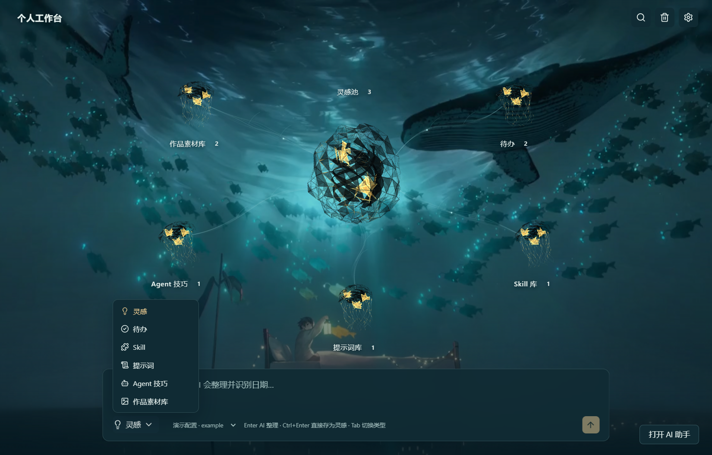

# Workbench 个人工作台

把零散想法，变成有迹可循的行动。

Workbench 是一个离线优先的 **Windows 桌面工作台**，把灵感池、作品素材、待办、Agent 技巧、Skills 和提示词放在一起。从快速捕捉一个念头，到整理知识、安排任务、复用 AI 工作流，都可以在同一个本地空间完成。

[下载 v0.5.0 Windows 版](https://github.com/letsgo-6/Workbench/releases/tag/v0.5.0) · [功能与验证状态](docs/STATUS.md) · [架构说明](docs/ARCHITECTURE.md) · [MIT License](LICENSE)


<details>
<summary>查看首页六类整理目标</summary>



</details>

_图片来自实际运行的 v0.5.0 原生界面，使用隔离数据库中的演示记录与演示配置；未使用个人数据或真实 API Key，安装后的内容默认为空。_

## 它能帮你做什么

| 场景         | 功能                                                                                                     |
| ------------ | -------------------------------------------------------------------------------------------------------- |
| 随手记录     | 全局快捷键呼出快速记录窗；灵感按天整理，支持标签、星标、日历和转为待办。                                 |
| 首页智能整理 | 首页输入框选择六类目标后拆分和提取字段，规则计算日期；流式单轮过程、预览确认、可靠结果可自动保存并撤销。 |
| 推进任务     | 今日与日期视图、优先级、顺延、单层子任务进度、提醒；AI 拆解先编辑建议，再确认创建。                      |
| 沉淀经验     | 保存 Agent 技巧、Markdown 笔记与来源，按工具组织，跨模块搜索。                                           |
| 管理 Skills  | 导入 `SKILL.md`、解析 frontmatter、文件夹批量导入、抓取 GitHub 链接并对比更新。                          |
| 复用提示词   | 识别 `{{变量}}`，填写后复制；保存版本、查看差异、回滚，最多保留 50 份。                                  |
| 收藏作品     | 完整作品瀑布流、UI 组件网格；图片/GIF/视频、封面与排序；组件提示词复制或填入 AI 输入框。                 |
| 连接 AI      | 配置 OpenAI 兼容服务，流式对话、`@` 引用本地条目、润色/总结/归类与每日小结。                             |
| 掌握数据     | SQLite 本地存储、回收站、JSON 导入/导出、Markdown 文件夹导出、每日数据库备份与恢复。                     |

首页以六个神经元显示数量与最近内容；点击节点进入模块，`Esc` 返回，`0–5` 切换模块（编辑时不拦截数字）。顶栏小地图、搜索、回收站和设置替代原侧栏。外观设置提供完整/简洁/关闭动效、系统减少动画，以及每天首次/每次/不播放开场与重播。

开发模式 `pnpm dev` 可进入 `#/__lab/neuron`，独立检查所有阶段、光粒/光球、节点状态、镜头和两种渲染器；生产包不包含该路由。当前本地 0.5.0 的检查、性能和人工待验项见 [PROGRESS](docs/PROGRESS.md)，当前公开下载版本为 0.5.0。

## 本地优先，写入由你确认

- 不配置 AI 也能使用本地记录、任务、搜索和导入导出。
- AI 请求会把你选择的内容发送给所配置的服务商；没有内置免费模型或服务端账号。
- 已保存的 API Key 由 Rust 存入系统凭据管理器，前端只获取掩码；JSON 备份不包含 Key。
- AI 结果先预览，点击替换、插入、应用或确认创建后才写入；编辑器内替换支持 `Ctrl+Z` 撤销。
- 首页可按六类目标整理，输入前缀会同步目标；默认目标在设置中修改。有模型时 Enter 整理，Ctrl+Enter 直接存灵感；无模型仍为灵感/待办手动保存。过程只保留当前一轮，运行时收起继续执行，结束后关闭需确认清除；推理与原始输出可独立折叠。
- 首页智能整理只提取字段，正文保留用户原文、链接只取自输入。日期以 Rust 规则为准，AI 兜底显示“AI 推断”；分析失败或取消保留输入。通用设置中可开启可靠结果直接保存，保存提示支持 8 秒内撤销；Alt+Space 小窗保持原操作。
- 内容默认保存在 `%APPDATA%\com.workbench.app`。JSON 导出采用 `formatVersion=1/schemaVersion=3`；完整备份包同时保存素材文件，支持导入 `schemaVersion=1/2` 的旧备份。

## 开始使用

从 [Releases](https://github.com/letsgo-6/Workbench/releases/tag/v0.5.0) 下载 Windows x64 安装包。启动后直接记录内容；需要 AI 时，在「设置 → 模型配置」中填写 Base URL、模型 ID 和自己的 Key。

| 操作                  | 默认快捷键                        |
| --------------------- | --------------------------------- |
| 全局快速记录          | `Alt+Space`，冲突时可在设置中更改 |
| 搜索与命令面板        | `Ctrl+K`                          |
| AI 助手               | `Ctrl+J`                          |
| 快速记录为灵感 / 待办 | `Enter` / `Ctrl+Enter`            |
| 关闭快速记录窗        | `Esc`                             |

搜索支持 `tag:统计 type:prompt is:starred 关键词`。浅色、深色和系统主题，以及编辑器字号，都可在设置中调整。

## 从源码运行

当前构建与验证平台为 Windows x64。需要 Node.js 24 LTS、pnpm 11、Rust MSVC、Visual Studio 2022 C++ 工具及 Windows SDK、WebView2。

PowerShell：

```powershell
git clone https://github.com/letsgo-6/Workbench.git
Set-Location Workbench
pnpm install --frozen-lockfile
pnpm dev
```

建议把工程放在英文、不受云盘同步影响的路径。已有完整 Windows SDK 时，脚本会使用 VS 开发者环境；缺少 SDK 时，可以通过项目提供的脚本准备项目内 SDK：

```powershell
powershell -NoProfile -ExecutionPolicy Bypass -File scripts/bootstrap-sdk.ps1
```

检查与打包：

```powershell
pnpm check
pnpm build
```

开发模式可在应用地址末尾打开 `#/__lab/neuron`，逐项测试开场、节点状态、光粒、光球、镜头以及静态降级；实验室不进入生产包。运行 `pnpm dev` 后，可在开发工具 Console 输入 `location.hash = "/__lab/neuron"`。

安装包生成于 `src-tauri/target/release/bundle/nsis/`。源码不包含第三方背景视频和参考素材；从源码构建时可自行提供背景媒体，未提供时使用纯色降级，全部本地与 AI 功能仍可用。详见 [媒体说明](public/scene-media/README.md)。`scripts/run.ps1` 只为当前构建进程注入工具链环境，不修改全局系统变量。

技术栈：Tauri 2、Rust、SQLite WAL、React 19、TypeScript、Vite、CodeMirror、TanStack Query。

## 当前状态

当前本地开发版本为 **0.5.0**，在[作品素材库与神经元首页](docs/PLAN-v0.3.md)基础上实施[六类目标整理与单轮过程](docs/PLAN-v0.5-target-capture.md)。首页提供目标选择、流式步骤/推理/结果、预览确认及查看/撤销；板块页继续使用顶栏与小地图。当前源码与 Windows 安装包同步到 v0.5.0。最新测试、打包和逐项验收见 [施工进度](docs/PROGRESS.md)。

从首页节点或板块小地图打开「作品素材库」，可添加作品/组件，拖入 PNG、JPEG、WebP、GIF、MP4、WebM（图片≤30 MB、视频≤300 MB、每批≤50个），或在非文本输入区粘贴截图和 URL。详情中拖动文件手柄排序，组件提示词可填写变量后复制，或填入 AI 助手但不会自动发送。「设置 → 外观」可调整动效。

迁移或完整备份请在「设置 → 数据」选择 `.wbbackup`，它包含原件与缩略图；JSON 仅含数据，需单独保管 assets。每日自动快照只备份数据库；彻底删除文件进入 `_purged/` 保留 30 天，更改数据目录会同时复制完整 assets。素材文件缺失时界面显示占位，不能通过 JSON 找回未另行保存的原件。

v0.2.0 为预览版。已验证 30 项前端测试、88 项 Rust 测试，以及 59 组原生功能检查；一万条混合数据的搜索测试均低于 200ms。这些是本机执行结果，详见 [验证状态](docs/STATUS.md)。

历史 0.2.0 的启动样本为 4.344 / 2.264 秒；不同版本的测量口径与证据边界记录在 PROGRESS，不将热缓存样本当作真实冷启动保证。安装版系统通知、真实 AI 服务商以及动画观感等仍需手动确认。当前未验证 macOS、Linux 和移动端。

欢迎通过 [Issues](https://github.com/letsgo-6/Workbench/issues) 提交问题和建议。贡献前请运行相应检查，并避免上传数据库、备份或凭据。

## 许可证

[MIT](LICENSE) 适用于本项目原创源码。安装包中的海底背景影片与展示截图中的对应画面为用户提供的第三方素材（《Wake up》，原画署名韩一杰），其版权独立保留，不因本项目 MIT 许可而转授；源码不包含原片或参考媒体。第三方依赖遵循各自的许可证；复制或生成的 UI 源码归属见 [第三方声明](THIRD_PARTY_NOTICES.md)。
